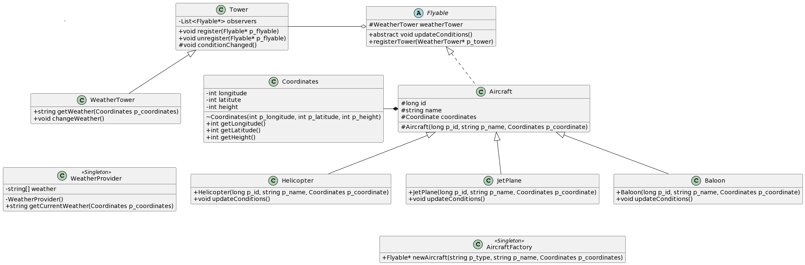

<div align="center">

# ✈️ avaj-launcher

**A weather-driven aircraft simulation written in pure Java, built around classic OOP design patterns.**


</div>

---

## 📖 Table of contents

- [About](#-about)
- [Design patterns](#-design-patterns)
- [UML diagram](#-uml-diagram)
- [Getting started](#-getting-started)
- [Scenario file format](#-scenario-file-format)
- [Simulation rules](#-simulation-rules)
- [Example output](#-example-output)
- [Error handling](#-error-handling)
- [Project structure](#-project-structure)

---

## 🛩 About

**avaj-launcher** is the first Java project of the 42 curriculum. The goal is to implement a minimal aircraft simulation program from a given UML class diagram, while strictly respecting its class hierarchy and access modifiers.

> *Frankfurt Airport faces bottlenecks on its landing runways because of frequent weather changes. To find out which scenarios cause the worst bottlenecks, the airport needs a simulator, designed by an architect who hands you a UML class diagram and three required design patterns.*

A scenario file describes a set of aircraft (balloons, helicopters and jet planes) and a number of simulation cycles. On each cycle, a **weather tower** generates the weather at every aircraft's position and notifies them. Each aircraft reacts to the weather according to its own type — climbing, drifting or descending — and lands once its height reaches `0`.

Every event is written to `simulation.txt`.

### Subject requirements

- [x] Java up to the latest LTS: no external libraries, no build tools, no code generators
- [x] No default package: everything lives in `io.github.zigeuh.avaj.*`
- [x] Every class of the UML diagram implemented, with its access modifiers and hierarchy
- [x] Observer, Singleton and Factory design patterns
- [x] Unique ID for each aircraft
- [x] Input validation: the program stops on invalid data and prints the error to standard output
- [x] **Bonus:** custom exceptions for abnormal behaviour

---

## 🧩 Design patterns

| Pattern | Where | Why |
| --- | --- | --- |
| **Observer** | `Tower` / `WeatherTower` ↔ `Flyable` | Aircraft register to the tower and get notified every time the weather changes. |
| **Singleton** | `WeatherProvider`, `AircraftFactory` | A single weather source and a single factory shared across the whole simulation. |
| **Factory** | `AircraftFactory#newAircraft` | Creates the right `Flyable` from its type name, so `Simulator` never instantiates concrete aircraft directly. |

---

## 🗺 UML diagram

<div align="center">



</div>

> The source of this diagram is available in [`global.puml`](global.puml) (PlantUML).

---

## 🚀 Getting started

### Requirements

- **Java 21** or newer (the code uses `List#getFirst()`)
- `javac` and `java` available in your terminal

### Compile

From the root of the repository, as required by the subject:

```bash
find * -name "*.java" > sources.txt
```

```bash
javac @sources.txt
```

### Run

```bash
java -cp src/ io.github.zigeuh.avaj.Simulator scenarios/valid/valid_main.txt
```

The simulation log is written to **`simulation.txt`** in the current directory.

```bash
cat simulation.txt
```

### Clean

```bash
find src -name "*.class" -delete
```

---

## 📄 Scenario file format

```text
25
Balloon B1 2 3 20
JetPlane J1 23 44 32
Helicopter H1 654 33 20
```

- **Line 1** — the number of times the weather changes (positive integer).
- **Following lines** — one aircraft per line:

```text
TYPE NAME LONGITUDE LATITUDE HEIGHT
```

| Field | Constraint |
| --- | --- |
| `TYPE` | `Balloon`, `JetPlane` or `Helicopter` (case-insensitive) |
| `NAME` | Any word without whitespace |
| `LONGITUDE`, `LATITUDE` | Positive integers |
| `HEIGHT` | Integer between `0` and `100` |

Fields can be separated by any whitespace (spaces or tabs), and blank lines are ignored.

---

## 🌦 Simulation rules

### Weather generation

Each 3D point has its own weather, among `RAIN`, `FOG`, `SUN` and `SNOW`. The subject leaves the algorithm free as long as it uses the coordinates; here it is:

```text
(longitude + latitude + height) % 4  →  RAIN | FOG | SUN | SNOW
```

### Aircraft behaviour

| Weather | 🎈 Balloon | 🚁 Helicopter | 🛫 JetPlane |
| :---: | :---: | :---: | :---: |
| ☀️ **SUN** | longitude **+2**, height **+4** | longitude **+10**, height **+2** | latitude **+10**, height **+2** |
| 🌧 **RAIN** | height **−5** | longitude **+5** | latitude **+5** |
| 🌫 **FOG** | height **−3** | longitude **+1** | latitude **+1** |
| ❄️ **SNOW** | height **−15** | height **−12** | height **−7** |

- Height is capped at **100**.
- When height reaches **0** or below, the aircraft **lands** and unregisters from the tower.
- Every weather change makes each aircraft log a message in the format `TYPE#NAME(UNIQUE_ID): SPECIFIC_MESSAGE`. The subject appreciates funny messages, and each aircraft has its own for every weather.

---

## 🖥 Example output

```text
Tower says: Balloon#B1(0) registered to weather tower.
Tower says: JetPlane#J1(2) registered to weather tower.
Tower says: Helicopter#H1(3) registered to weather tower.
Balloon#B1(0): Down we go into the soup! Hold tight while I find us a nice little clearing to land.
JetPlane#J1(2): Brrr, the wings are turning into ice skates! Requesting a quick de-ice session so we don't slide off target.
Helicopter#H1(3): Whoa, it’s a full whiteout out there! I’m easing down before we end up as a frozen ice pop.
...
Helicopter#H1(3) landing.
Tower says: Helicopter#H1(3) unregistered from weather tower.
...
Balloon#B1(0): Looks like the rain is giving our balloon an unexpected weight-loss workout, time to burn a bit more fuel to stay up!
Balloon#B1(0) landing.
Tower says: Balloon#B1(0) unregistered from weather tower.
```

Each aircraft is identified as `Type#Name(id)`, where `id` is a unique number assigned by the factory.

---

## 🛡 Error handling

Invalid scenarios are rejected **before** the simulation starts (and before `simulation.txt` is created), with a clear message on the standard output. As a bonus, two custom exceptions are used: `InvalidScenarioException` and `InvalidNumberInputException`.

| Case | Example message |
| --- | --- |
| Empty file | `Invalid Scenario - scenario.txt is empty.` |
| First line isn't an integer | `Invalid Number Input - First line "abc" is not a valid integer.` |
| Simulation count ≤ 0 | `Invalid Number Input - Simulation count must be a positive integer (found: 0).` |
| No aircraft | `Invalid Scenario - scenario.txt doesn't contain any aircraft.` |
| Missing fields | `Invalid Scenario - Invalid scenario line format: Balloon B1 1 2` |
| Unknown aircraft type | `Invalid Scenario - UFO is not a valid flyable type.` |
| Non-numeric coordinates | `Invalid Number Input - Coordinates must be valid integers in line: Balloon B1 a 2 3` |
| Negative coordinates | `Invalid Number Input - Coordinates cannot be negative in line: Balloon B1 -1 2 3` |
| Height > 100 | `Invalid Number Input - Initial height cannot exceed 100 in line: Balloon B1 1 2 101` |

Test scenarios for every case live in [`scenarios/`](scenarios).
---

## 📁 Project structure

```text
avaj-launcher
├── scenarios
│   ├── valid/                      # Scenarios that should run
│   └── invalid/                    # Scenarios that should be rejected
└── src/io/github/zigeuh/avaj
    ├── Simulator.java              # Entry point: parsing, validation, main loop
    ├── aircraft
    │   ├── Flyable.java            # Abstract observer
    │   ├── Aircraft.java           # Common aircraft base (id, name, coordinates)
    │   ├── Balloon.java
    │   ├── Helicopter.java
    │   ├── JetPlane.java
    │   ├── Coordinates.java        # Immutable position
    │   └── AircraftFactory.java    # Singleton factory
    ├── weather
    │   ├── Tower.java              # Observable subject
    │   ├── WeatherTower.java
    │   └── WeatherProvider.java    # Singleton weather generator
    ├── exceptions
    │   ├── InvalidScenarioException.java
    │   └── InvalidNumberInputException.java
    └── utils
        └── Logger.java             # Writes to simulation.txt
```
